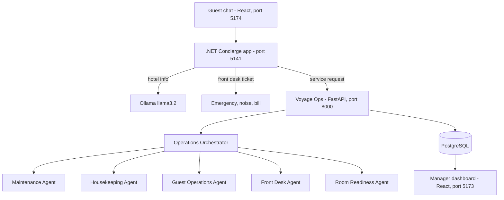

# Autonomous Hotel Operations Platform (Voyage Ops)

A multi-agent AI system that runs the day-to-day operations of a hotel.

Guests send requests in a chat (AC not working, extra pillows, early check-in, late check-out). The system understands the message, checks hotel policy and room status, assigns the work to the right staff member or sends it to the front desk, and replies to the guest with a clear decision: **APPROVE**, **ESCALATE** or **REJECT**. Managers see everything live on a dashboard.

## How it works



1. The guest chat sends the message to the **.NET Concierge app**, which works out what the guest wants.
2. Hotel information questions are answered directly. Emergencies, noise and billing go to the front desk.
3. Service requests (maintenance, housekeeping, check-in, check-out) go to **Voyage Ops**, the FastAPI "brain".
4. The **Operations Orchestrator** hands the request to the right agent.
5. Everything is stored in PostgreSQL and shown on the manager dashboard. Request status is synced back to the guest every 10 seconds.

## Agents

| Agent | What it does | Status |
|---|---|---|
| Operations Orchestrator | Receives events and routes them to the right agent | Completed |
| Room Readiness | Scores how urgently a room must be ready after check-out (next guest, VIP, early check-in) | Completed |
| Housekeeping | Assigns cleaning work to staff on the same floor and tracks room status | Completed |
| Issue Classifier | Reads maintenance text and classifies category and severity (Ollama, with keyword fallback) | Completed |
| Maintenance | Work orders, SLAs, technician assignment, duplicate detection, safety isolation | Completed |
| Guest Operations | Amenity requests (items, quantities, stock limits) and early check-in decisions | Completed |
| Front Desk | Late check-out decisions. Room change and other front desk capabilities are planned | In progress |

### Duplicate request detection

Every maintenance message is turned into an issue type (`wifi`, `ac`, `tv`, `plumbing`, `light`, `door`, `other`). A request is a duplicate when the **room**, the **issue type** and an **open ticket** all match, so "wifi is not working" and "internet is down" create one task, not two. A database lock keeps this safe when two requests arrive at the same moment.

### Late check-out rules

The Front Desk Agent checks, in this order, and the first match decides:

1. Time cannot be understood: **ESCALATE**
2. No active stay for the room: **REJECT**
3. Requested time is at or before standard check-out (11:00): **APPROVE**
4. No guest arriving the same day: **APPROVE** up to standard check-in (14:00), otherwise **ESCALATE**
5. Another guest arriving the same day: **APPROVE** only if the room can be cleaned (30 to 50 minutes by room type) plus a 30-minute buffer before that guest arrives, otherwise **ESCALATE** (VIP guests are marked in the reason)

Standard times come from the `hotel_policy` table.

## Tech stack

| Part | Technology |
|---|---|
| Backend (Voyage Ops) | Python, FastAPI, SQLAlchemy, Alembic |
| Database | PostgreSQL 15 |
| AI model | Ollama with `llama3.2` (keyword fallback when offline) |
| Guest Concierge backend | .NET 8 (ASP.NET Core), runs in Docker |
| Frontends | React (manager dashboard and guest app) |
| Auth | JWT |

## Repository structure

| Folder | Contents |
|---|---|
| `hotel-agentic-ai/` | Voyage Ops FastAPI backend, agents, tests and the `frontend/` manager dashboard |
| `HotelConcierge/HotelConcierge/` | Guest Concierge: .NET backend and `HotelConciergeFrontend` (React guest app) |
| `docker-hotelconcierge/` | Dockerfile for the .NET backend |
| `backups/` | Database backups taken during test-data cleanup |
| `test-qr/` | QR codes for the demo rooms |

## Requirements

- Git
- Python 3.14 (developed on 3.14.7)
- Node.js (LTS) and npm
- Docker Desktop (PostgreSQL, Ollama and the .NET backend run in Docker)
- Free ports: 5432, 11434, 5141, 7225, 8000, 5173, 5174

## Setup and run

### 1. Get the code

```bash
git clone https://github.com/vedantibeleEOV/Hotel-Multiagent-System.git
cd Hotel-Multiagent-System
```

### 2. Start PostgreSQL and Ollama

```bash
docker run -d --name hotel_postgres -e POSTGRES_PASSWORD=<choose-a-password> -p 5432:5432 postgres:15-alpine
docker run -d --name hotel_llm -p 11434:11434 -v ollama:/root/.ollama ollama/ollama
docker exec hotel_llm ollama pull llama3.2
```

Create the database that `hotel-agentic-ai/.env.example` expects.

### 3. Start the FastAPI backend

```bash
cd hotel-agentic-ai
python -m venv .venv
.venv\Scripts\activate          # Windows
pip install -r requirements.txt
pip install tzdata
copy .env.example .env          # then fill in your own values
alembic upgrade head
python main.py
```

Open http://127.0.0.1:8000/docs for the API (Swagger). To load the sample hotel data, call `POST /api/reset` or use **Reset DB** on the dashboard.

### 4. Start the manager dashboard

```bash
cd hotel-agentic-ai/frontend
npm install
npm run dev
```

Open http://localhost:5173.

### 5. Start the Guest Concierge backend (Docker)

The .NET backend is built and run in Docker.

```bash
docker build -f docker-hotelconcierge/Dockerfile -t hotelconcierge "HotelConcierge/HotelConcierge/HotelConcierge"
docker run -d --name hotelconcierge --restart unless-stopped -p 5141:5141 -p 7225:7225 --env-file hotelconcierge.env hotelconcierge
```

Create `hotelconcierge.env` yourself (it is not in the repository) with these settings:

```
VoyageOps__Enabled=true
VoyageOps__BaseUrl=http://host.docker.internal:8000
VoyageOps__Username=<voyage-ops-login>
VoyageOps__Password=<voyage-ops-password>
ConnectionStrings__DefaultConnection=<postgres-connection-string>
Ollama__BaseUrl=http://host.docker.internal:11434
Ollama__Model=llama3.2
ASPNETCORE_URLS=<urls>
```

If you use the HTTPS port, also set the Kestrel certificate path and password and mount your certificate folder at `/certs`.

### 6. Start the guest app

```bash
cd HotelConcierge/HotelConcierge/HotelConciergeFrontend
npm install
npm run dev
```

Open http://localhost:5174 and chat as a guest of a room (for example Room 405).

### Try it

1. Send `wifi is not working in my room`. A maintenance task appears on the dashboard Tasks page.
2. Send `internet is down`. The guest is told the request is already being handled and no second task is created.
3. Send `what is the wifi password`. The guest gets the hotel information.

## Main API endpoints

| Endpoint | Purpose |
|---|---|
| `POST /api/events/maintenance-issue` | Report a maintenance issue (returns `DUPLICATE` for an open duplicate) |
| `POST /api/events/checkout` | Guest check-out, starts room turnaround |
| `POST /api/events/early-checkin` | Early check-in decision |
| `POST /api/events/late-checkout` | Late check-out decision |
| `POST /api/reset` | Reset to the sample data (testing only) |

## Tests

```bash
cd hotel-agentic-ai
python -m pytest -q
```

Some older tests (19) currently fail and are being looked at. All tests for the duplicate detection, early check-in and late check-out flows pass.

## Security

Never commit `.env` files, database passwords, JWT secrets or HTTPS certificates. Keep them in files that are listed in `.gitignore`.

## Roadmap

- Connect late check-out to the guest chat
- Fix the "Is my room ready?" question in the guest chat
- Room change, room assignment, upgrade recommendations, no-show handling and overbooking assistance in the Front Desk Agent

